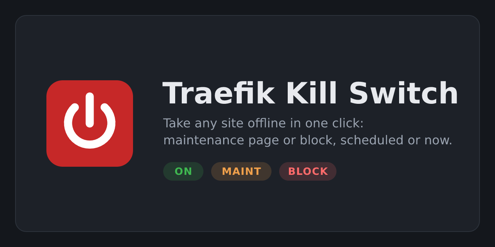

# Traefik Kill Switch



> **Beta.** Tested against Traefik v3.7. Feedback and issues welcome.

A Traefik middleware plugin that does nothing until you need it. When you need it, a web page lets you
switch any site, or all of them at once, to:

| Mode    | Visitors get                                   |
|---------|------------------------------------------------|
| `on`    | the site, untouched (default)                  |
| `maint` | `503` + a maintenance page (yours or built-in) |
| `block` | `403 Forbidden`, the backend is never reached  |

Use it when a vulnerable app has to come off the internet *now*. You click a button and it's done:
there's no config edit, no container restart and no Traefik reload. A switch takes effect within one second.

## How it works

- Attach the middleware to an entry point (or to individual routers). Each request is checked against
  its `Host` in a small JSON state file.
- A second instance of the same plugin, with `admin: true`, serves the web page on a router of its own
  and writes the state file.
- `*` is the global switch. If it isn't `on`, it overrides every per-host setting.
- If the state file is missing, everything is `on`. If it becomes unreadable or corrupt, the last good
  state is kept, so a broken file can't silently reopen a blocked site.

## Setup

### 1. Load the plugin

From the plugin catalog (static config):

```yaml
experimental:
  plugins:
    killswitch:
      moduleName: github.com/nenchi/traefik-killswitch
      version: v0.1.0
```

Or as a local plugin, e.g. while testing a fork. Mount the repo at
`/plugins-local/src/github.com/nenchi/traefik-killswitch` in the Traefik container, then:

```yaml
experimental:
  localPlugins:
    killswitch:
      moduleName: github.com/nenchi/traefik-killswitch
```

### 2. Give Traefik a writable directory for the state

```yaml
# docker compose, traefik service
volumes:
  - ./killswitch:/data
```

### 3. Gate the sites and add the admin page (dynamic config)

```yaml
http:
  middlewares:
    killswitch:
      plugin:
        killswitch:
          stateFile: /data/killswitch.json
          # maintenanceFile: /data/maintenance.html   # optional custom page
          excludeHosts:                 # never gated, so "*" can't lock you out
            - killswitch.example.com
            - auth.example.com          # your SSO login page, if it's on the same entry point
    killswitch-admin:
      plugin:
        killswitch:
          stateFile: /data/killswitch.json
          admin: true

  routers:
    killswitch-admin:
      rule: Host(`killswitch.example.com`)
      entryPoints: [websecure]      # fine when its host is in excludeHosts
      middlewares: [your-auth, killswitch-admin]
      service: noop@internal
```

To gate every site at once, add the middleware to the entry point (static config):

```yaml
entryPoints:
  websecure:
    address: ":443"
    http:
      middlewares: [killswitch@file]
```

Or add it to individual routers, e.g. with the Docker label
`traefik.http.routers.myapp.middlewares=killswitch@file`.

## Options

| Option            | Default                 | Description                                                         |
|-------------------|-------------------------|---------------------------------------------------------------------|
| `stateFile`       | `/data/killswitch.json` | Shared JSON state. Must be writable for the admin instance.         |
| `admin`           | `false`                 | Serve the web page instead of gating. Never forwards to a backend.  |
| `maintenanceFile` | built-in page           | HTML served with `503` in `maint` mode. Edits apply immediately.   |
| `apiURL`          | none                    | Admin only. Traefik's API (e.g. `http://127.0.0.1:8080`, needs `api.insecure` or another way to reach it from inside Traefik). Lets the admin page list every protected host and refuse hosts whose router doesn't use the kill switch. |
| `excludeHosts`    | none                    | Hosts that are never gated: the admin page and your auth provider. Listed on the admin page as "Always on". |

You can also edit the state file by hand or from a script:

```json
{ "*": "on", "app.example.com": "maint", "api.example.com": "maint:downtime", "old.example.com": "block" }
```

`maint:downtime` means maintenance mode with the `downtime` template (see below). A value can also carry
a scheduled window: `"on|block|2026-10-26T22:00:00+01:00|2026-10-27T02:00:00+01:00"` (optionally followed by
`|<created>|<user>|daily` or `|weekly`) means "normally on,
blocked during that window".

## Which hosts can be switched

A host can only be switched off if its router uses the kill switch middleware. With `apiURL` set on the
admin middleware, the plugin reads Traefik's routers and middlewares (including chains) every 10 seconds:

- every protected host is listed right away, even before it gets traffic;
- hosts whose router lacks the middleware are listed under **Not protected**, with the router names;
- switching an unknown host (a typo) or an unprotected one is refused with an explanation.
  Switching back **on** and cancelling a schedule always work.

Without `apiURL`, switching a host that hasn't passed the kill switch since Traefik started saves the
setting but shows a warning.

## Scheduled windows

Every row on the admin page (including "All sites") has a **Schedule…** section: pick `maint` (and a page)
or `block`, plus a start and an end. During the window the site gets that mode; before and after, it has
its normal mode. Nobody has to be around to switch it off or back on.

- **Repeat:** once, daily or weekly. A weekly window from Sun 03:00 to Sun 04:00 runs every Sunday
  03:00–04:00 until you cancel it; the page shows the next run. Wall-clock times are kept across
  daylight saving changes.
- One window per site. Planning a new one replaces it; **Cancel** removes it.
- A one-off window removes itself when it ends, so finished schedules disappear from the page.
- The window is checked on every request, so it starts and ends on time, to the second.
- Times are entered and shown in server time (the Traefik container's time zone, e.g. `TZ=Europe/Berlin`).
  The admin page shows the zone and the current server time.
- During a `maint` window, `Retry-After` tells clients when the window ends.

## Logging

Every change is written to Traefik's log as an INFO line, with the user (from basic auth or Authentik's
`X-Authentik-Username`) and the client IP:

```
2026-10-26T21:14:02+01:00 INF KILL-SWITCH: app.example.com set to maint (page downtime) by alice from 192.168.1.50
2026-10-26T21:15:40+01:00 INF KILL-SWITCH: schedule created for all sites: block from Mon 26 Oct 22:00 to Tue 27 Oct 02:00 CET by alice from 192.168.1.50
2026-10-26T22:00:00+01:00 INF KILL-SWITCH: schedule started for all sites: block until Tue 27 Oct 02:00 CET (created Mon 26 Oct 21:15 by alice)
2026-10-27T02:00:00+01:00 INF KILL-SWITCH: schedule ended for all sites: back to on
```

A window that's already running when Traefik starts is logged as `schedule active since …`.

The same entries are kept in `<stateFile>.history` (the newest 1000) and shown on the admin page under
**History**, so they survive restarts and Docker log rotation.
Filter with `docker logs traefik 2>&1 | grep KILL-SWITCH`. Errors are logged at ERR level as before.

## Custom maintenance page

Start from [`examples/maintenance.html`](examples/maintenance.html): copy it next to the state file
(e.g. `/data/maintenance.html`), edit the text, and set `maintenanceFile: /data/maintenance.html`.

- **Keep it one self-contained file.** While a site is in maintenance, every request to it returns this
  page, including requests for its CSS, images and fonts. Inline your styles, and use inline SVG or `data:` URIs for images.
- Edits apply immediately, with no restart. If the file is missing or unreadable, the built-in page
  is served and an error is logged, so a bad path can't break your sites.

### Several pages: templates per site

Every other `.html` file in the same directory as `maintenanceFile` is a template you can pick per site
in the admin page. For example, add [`examples/downtime.html`](examples/downtime.html) for unplanned
outages and [`examples/scheduled.html`](examples/scheduled.html) for planned work such as a weekly update window:

```
/data/maintenance.html   ← default page
/data/downtime.html      ← shows up as "downtime"
/data/scheduled.html     ← shows up as "scheduled"
```

Each row on the admin page then gets a dropdown: pick a page and click **maint**. To switch a site that's
already in maintenance to another page, pick it and click **maint** again. File names may contain only
letters, digits, `-` and `_`. If a picked template is later deleted, the default page is served.

## Security

- **Put authentication in front of the admin router** (forwardAuth, Authelia, Authentik, basicAuth, an IP
  allowlist). Anyone who can reach the page can take your sites down.
- If the admin page or your SSO login runs on an entry point the kill switch gates, put their hosts in
  `excludeHosts`. Otherwise setting `*` to `block` locks you out of the switch, and you'd have to
  edit the file by hand.
- Cross-site form posts are rejected (`Origin` / `Sec-Fetch-Site` checks).

## Limitations

- The admin page lists hosts that are already in the state file, plus hosts seen since Traefik started.
  You can add any other host with the form.
- Matching is by exact host name. There are no wildcards or path rules.

## Development

```sh
go test -race ./...
yaegi test .                         # Traefik's interpreter; catches bugs plain Go doesn't
TRAEFIK=/path/to/traefik test/integration.sh   # end-to-end against a real Traefik binary
```

The Yaegi interpreter mishandles tuple assignments that include `nil` or struct fields
(`a.x, a.y = 1, 2`), so the code uses separate statements on purpose. Keep it that way.

## License

MIT
