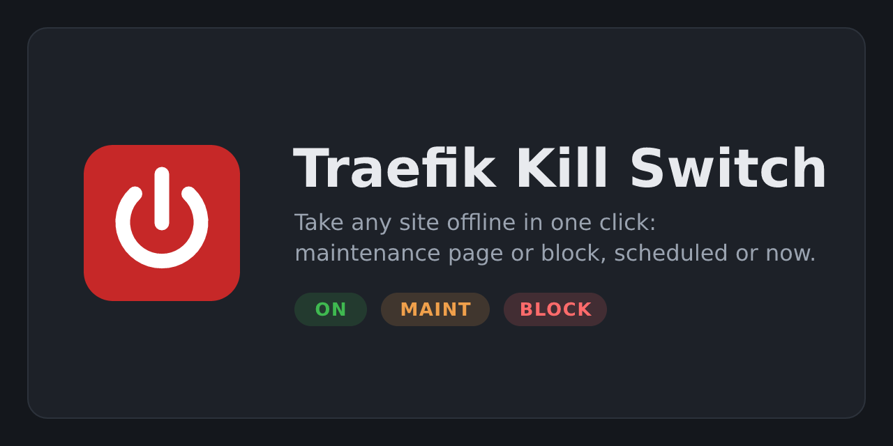
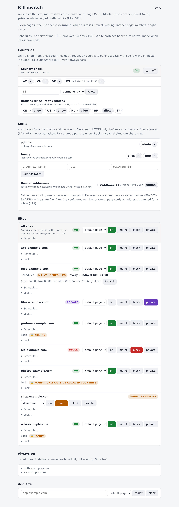
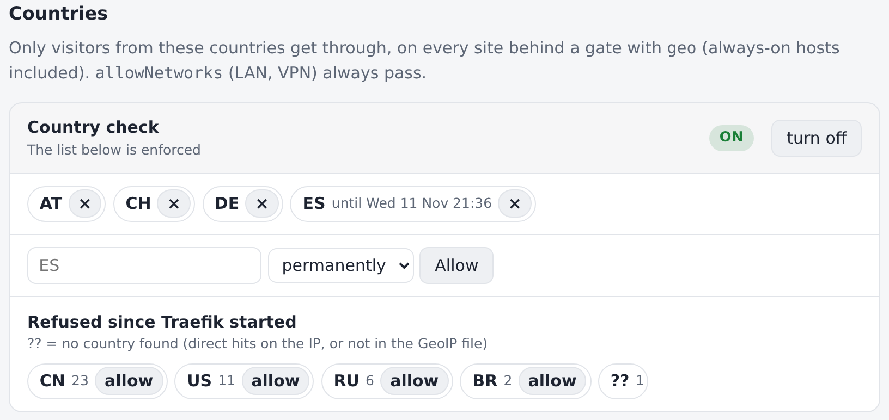
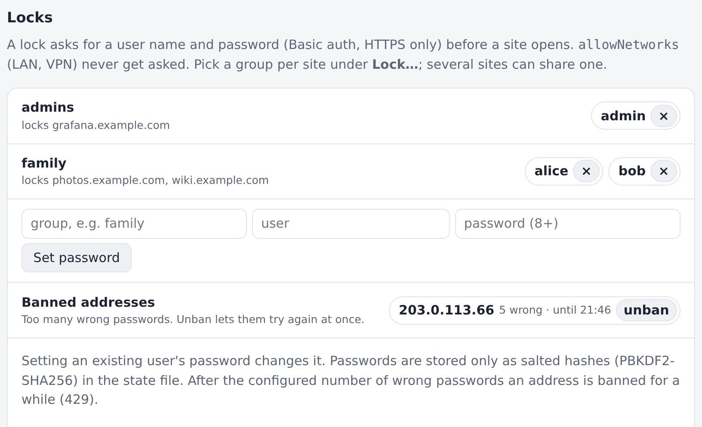

# Traefik Kill Switch



> For Traefik v3 (tested against v3.7). Feedback and issues welcome.

A Traefik middleware plugin that does nothing until you need it. When you need it, a web page lets you
switch any site, or all of them at once, to:

| Mode    | Visitors get                                   |
|---------|------------------------------------------------|
| `on`    | the site, untouched (default)                  |
| `maint` | `503` + a maintenance page (yours or built-in) |
| `block` | `403 Forbidden`, the backend is never reached  |
| `private` | the site from your LAN/VPN (`allowNetworks`) only, `403` for everyone else |

Optionally, it can also keep a **country allow-list** (geoblocking) that you edit with a few clicks, e.g. to
let a country in for the week you travel there, and put **password locks** (htaccess-style) on sites. Both are
off unless you configure them, see [Country allow-list](#country-allow-list-geo) and [Password locks](#password-locks).

<picture>
  <source media="(prefers-color-scheme: dark)" srcset=".assets/admin-dark.png">
  
</picture>

Use it when a vulnerable app has to come off the internet *now*. You click a button and it's done:
there's no config edit, no container restart and no Traefik reload. A switch takes effect within one second.

## How it works

- Attach the middleware to an entry point (or to individual routers). Each request is checked against
  its `Host` in a small JSON state file.
- A second instance of the same plugin, with `admin: true`, serves the web page on a router of its own
  and writes the state file.
- `*` is the global switch. If it isn't `on`, it overrides every per-host setting.
- If the state file is missing, everything is `on`. If it becomes unreadable or corrupt, the last good
  state is kept, so a broken file can't silently reopen a blocked site.

## Setup

### 1. Load the plugin

From the plugin catalog (static config):

```yaml
experimental:
  plugins:
    killswitch:
      moduleName: github.com/nenchi/traefik-killswitch
      version: v0.7.0
```

Or as a local plugin, e.g. while testing a fork. Mount the repo at
`/plugins-local/src/github.com/nenchi/traefik-killswitch` in the Traefik container, then:

```yaml
experimental:
  localPlugins:
    killswitch:
      moduleName: github.com/nenchi/traefik-killswitch
```

### 2. Give Traefik a writable directory for the state

```yaml
# docker compose, traefik service
volumes:
  - ./killswitch:/data
```

### 3. Gate the sites and add the admin page (dynamic config)

```yaml
http:
  middlewares:
    killswitch:
      plugin:
        killswitch:
          stateFile: /data/killswitch.json
          # maintenanceFile: /data/maintenance.html   # optional custom page
          excludeHosts:                 # never gated, so "*" can't lock you out
            - killswitch.example.com
            - auth.example.com          # your SSO login page, if it's on the same entry point
    killswitch-admin:
      plugin:
        killswitch:
          stateFile: /data/killswitch.json
          admin: true

  routers:
    killswitch-admin:
      rule: Host(`killswitch.example.com`)
      entryPoints: [websecure]      # fine when its host is in excludeHosts
      middlewares: [your-auth, killswitch-admin]
      service: noop@internal
```

To gate every site at once, add the middleware to the entry point (static config):

```yaml
entryPoints:
  websecure:
    address: ":443"
    http:
      middlewares: [killswitch@file]
```

Or add it to individual routers, e.g. with the Docker label
`traefik.http.routers.myapp.middlewares=killswitch@file`.

## Options

| Option            | Default                 | Description                                                         |
|-------------------|-------------------------|---------------------------------------------------------------------|
| `stateFile`       | `/data/killswitch.json` | Shared JSON state. Must be writable for the admin instance.         |
| `admin`           | `false`                 | Serve the web page instead of gating. Never forwards to a backend.  |
| `maintenanceFile` | built-in page           | HTML served with `503` in `maint` mode. Edits apply immediately.   |
| `apiURL`          | none                    | Admin only. Traefik's API (e.g. `http://127.0.0.1:8080`, needs `api.insecure` or another way to reach it from inside Traefik). Lets the admin page list every protected host and refuse hosts whose router doesn't use the kill switch. |
| `geo`             | none (off)              | Gates only. Optional country allow-list, see [below](#country-allow-list-geo). |
| `locks`           | none (off)              | Gates only. Optional password locks: `enabled: true`, see [below](#password-locks). |
| `allowNetworks`   | none                    | Gates only. Your LAN/VPN (CIDRs). They pass `private`, skip locks and the country check. |
| `trustedProxies`  | none                    | Gates only. Your CDN/proxy (CIDRs): its `X-Forwarded-For`, `X-Forwarded-Proto` and country header are believed. |
| `historyMax`      | `1000`                  | Entries kept in `<stateFile>.history`. Set it on any middleware with that state file; the largest value applies to all of them. |
| `excludeHosts`    | none                    | Hosts that are never gated: the admin page and your auth provider. `*.home.arpa` matches every host under `home.arpa` (e.g. a VPN-only domain). Listed on the admin page as "Always on". |

You can also edit the state file by hand or from a script:

```json
{ "*": "on", "app.example.com": "maint", "api.example.com": "maint:downtime", "old.example.com": "block" }
```

`maint:downtime` means maintenance mode with the `downtime` template (see below). Keys starting with `@` are
not sites: `@geo` / `@geo-off` hold the country list, `@lockgroup:<group>` and `@lock:<host>` the locks. A value can also carry
a scheduled window: `"on|block|2026-10-26T22:00:00+01:00|2026-10-27T02:00:00+01:00"` (optionally followed by
`|<created>|<user>|daily` or `|weekly`) means "normally on,
blocked during that window".

## Which hosts can be switched

A host can only be switched off if its router uses the kill switch middleware. With `apiURL` set on the
admin middleware, the plugin reads Traefik's routers and middlewares (including chains) every 10 seconds:

- every protected host is listed right away, even before it gets traffic;
- hosts whose router lacks the middleware are listed under **Not protected**, with the router names;
- switching an unknown host (a typo) or an unprotected one is refused with an explanation.
  Switching back **on** and cancelling a schedule always work.

Without `apiURL`, switching a host that hasn't passed the kill switch since Traefik started saves the
setting but shows a warning.

### Grouping

With `apiURL`, names served by the same Traefik service (container) under the same domain are shown as one
row and switched together: `m.example.com + media.example.com` is one row, while `media.home.arpa` (same
container, LAN domain) stays separate. If the names of a row were switched one by one and differ, the row
shows **mixed** with each name's mode, and one click aligns them. A group is only switched when every name
in it passes the checks. **Group by service: on / off** at the top of the page toggles this per browser
(cookie). The domain is the last two labels of a name. The history keeps one entry per name.

## Scheduled windows

Every row on the admin page (including "All sites") has a **Schedule…** section: pick `maint` (and a page)
or `block`, plus a start and an end. During the window the site gets that mode; before and after, it has
its normal mode. Nobody has to be around to switch it off or back on.

- **Repeat:** once, daily or weekly. A weekly window from Sun 03:00 to Sun 04:00 runs every Sunday
  03:00–04:00 until you cancel it; the page shows the next run. Wall-clock times are kept across
  daylight saving changes.
- One window per site. Planning a new one replaces it; **Cancel** removes it.
- A one-off window removes itself when it ends, so finished schedules disappear from the page.
- The window is checked on every request, so it starts and ends on time, to the second.
- Times are entered and shown in server time (the Traefik container's time zone, e.g. `TZ=Europe/Berlin`).
  The admin page shows the zone and the current server time.
- During a `maint` window, `Retry-After` tells clients when the window ends.

## Country allow-list (geo)

**Off by default.** If you only want maintenance and block, leave `geo` out: there's no country check and no
Countries card on the admin page, exactly as before v0.6.0. The card appears as soon as at least one gate
middleware has `geo`, and the list then applies to the sites behind those gates. Gates without `geo` keep
working as plain kill switches, so you can geoblock some routers and not others.

Add `geo` to a gate middleware and only visitors from the countries on a list get through; everyone else
gets `403`. The list is edited on the admin page (**Countries**, at the top) and applies on the next request:

- **Allow** a country permanently, or for 1, 7, 14 or 30 days (it is removed again when the time is up).
- **×** removes a country.
- **Refused since Traefik started** shows which countries were turned away, with a one-click **allow**.
- **turn off / turn on** switches the whole country check off (every country gets through) and back on;
  the list is kept meanwhile. To remove the feature completely, delete the `geo` block from the config.

Every change is logged and kept in the History like the other switches.



The plugin needs to know each visitor's country. It can read it from a header that a CDN or proxy in
front of Traefik adds, look it up in a GeoIP file, or both (header first, file as fallback):

| Setup in front of Traefik                       | Config                                                       |
|-------------------------------------------------|--------------------------------------------------------------|
| Cloudflare (proxied DNS or Tunnel)              | `countryHeader: CF-IPCountry` + `trustedProxies`: Cloudflare's ranges |
| AWS CloudFront                                  | `countryHeader: CloudFront-Viewer-Country` + `trustedProxies` |
| nginx / HAProxy / another proxy with GeoIP      | `countryHeader: X-Country-Code` (whatever it sets) + `trustedProxies` |
| Nothing: Traefik is directly on the internet    | `geoipFile: /data/country.mmdb`                              |

```yaml
http:
  middlewares:
    killswitch:
      plugin:
        killswitch:
          stateFile: /data/killswitch.json
          geo:
            countryHeader: CF-IPCountry
            trustedProxies:            # the header is only believed from these addresses
              - 173.245.48.0/20        # ... all of https://www.cloudflare.com/ips/
            # geoipFile: /data/country.mmdb
            allowNetworks:             # always pass: LAN, VPN
              - 192.168.0.0/16
              - 10.0.0.0/8
            countries: [DE, AT, CH]    # starting list, until the first change on the admin page
            # unknown: block           # no country found: block (default) or allow
```

### Only some sites geoblocked

Use two gate middlewares with the same `stateFile`: a plain one for every site, and one with `geo` for the
routers that should be geoblocked. Both are switched from the same admin page.

```yaml
http:
  middlewares:
    killswitch:                    # plain kill switch, e.g. on the entry point for every site
      plugin:
        killswitch:
          stateFile: /data/killswitch.json
    killswitch-geo:                # the same, plus the country check
      plugin:
        killswitch:
          stateFile: /data/killswitch.json
          geo:
            countryHeader: CF-IPCountry
            trustedProxies: [173.245.48.0/20]   # ... all of https://www.cloudflare.com/ips/
            allowNetworks: [192.168.0.0/16, 10.0.0.0/8]
            countries: [DE, AT, CH]
```

Then attach `killswitch-geo` to the routers that need it, e.g. with a Docker label:

```yaml
labels:
  - "traefik.http.routers.wiki.middlewares=killswitch-geo@file"
```

Sites behind `killswitch` only are reachable from every country; sites behind `killswitch-geo` follow the
Countries list on the admin page.

| `geo` option     | Description |
|------------------|-------------|
| `countryHeader`  | Header with the visitor's ISO country code. Requires `trustedProxies`. |
| `trustedProxies` | CIDRs or addresses of your CDN/proxy. Only requests from these may set the country header, and the visitor's address is the rightmost `X-Forwarded-For` entry that isn't one of them. Entries may be comma-separated. Also list them in the entry point's `forwardedHeaders.trustedIPs`: Traefik deletes `X-Forwarded-For` from anyone else before plugins see it, so `geoipFile` and `allowNetworks` would only see the proxy's address. |
| `geoipFile`      | A MaxMind DB (`.mmdb`) country file. Re-read within a minute when it changes, so a monthly update needs no restart. |
| `allowNetworks`  | CIDRs that always pass, whatever the list says. Put your LAN and VPN here so you can always reach the admin page. |
| `countries`      | The list used until the admin page saves one. After that the saved list (`@geo` in the state file) wins. |
| `unknown`        | `block` (default) or `allow` when no country can be found: a request that didn't come through a trusted proxy and isn't in the GeoIP file, or a missing file. |

**GeoIP files.** Free country files in this format: [DB-IP Lite Country](https://db-ip.com/db/download/ip-to-country-lite)
(CC BY 4.0, no account, monthly) or [MaxMind GeoLite2-Country](https://dev.maxmind.com/geoip/geolite2-free-geolocation-data)
(free account). City files work too. The plugin reads the file itself (no extra dependency); keep it
up to date with a cron job or MaxMind's `geoipupdate`.

Good to know:

- **Close the side door.** With `countryHeader`, a request that reaches Traefik directly (not through the
  CDN) has no trusted country, so it's `unknown` and blocked by default. That's on purpose: otherwise anyone
  who knows your server's IP could skip the CDN and the country check. Ports other than the gated entry
  points (SSH, WireGuard, ...) are not affected.
- **`excludeHosts` are checked too.** They are only exempt from on/maint/block, not from the country list, so
  your SSO and password manager stay geoblocked. Reach them through `allowNetworks` when you're away.
- The list is the same for every site behind gates with `geo`. Codes are ISO 3166-1 alpha-2; Cloudflare
  also sends `XX` (unknown) and `T1` (Tor), which you can allow like any other code.
- Locked yourself out? Connect through an `allowNetworks` address (VPN), or edit `@geo` in the state file:
  `"@geo": "DE,AT,ES@2026-11-11T18:00:00+01:00"` (a country with `@time` is allowed until then). While the check is
  switched off, the state file has an `"@geo-off"` entry; deleting it switches it back on.

## Password locks

**Off by default.** Add `locks` to a gate and sites behind it can be locked with a user name and password,
like an `.htaccess` lock, from the admin page:

```yaml
killswitch:
  plugin:
    killswitch:
      stateFile: /data/killswitch.json
      allowNetworks: [192.168.0.0/16, 10.0.0.0/8]   # LAN, VPN: never asked
      locks:
        enabled: true
        # maxFailures: 5    # wrong passwords per address before a ban
        # banMinutes: 10    # ban length
```

With Docker labels: `traefik.http.middlewares.killswitch.plugin.killswitch.locks.enabled=true`.



- **Lock groups:** create a group (e.g. `family`) by adding a user and password in the **Locks** card; add more
  users the same way, and setting an existing user's password changes it.
- **Lock a site:** open **Lock…** in its row and pick a group. Several sites can share one group; a grouped row
  (e.g. `wiki.example.com + w.example.com`) is locked as a whole.
- **When** (only on gates with `geo`):
  - **always:** every visitor must log in. On a geo gate, other countries still get `403` before any login
    prompt, so they can't even try passwords.
  - **only outside allowed countries:** visitors from the Countries list go straight in, everyone else gets
    the login prompt instead of `403`. Handy when you travel without a VPN; it does show the prompt to the world.

| Gate        | Lock                      | Allowed country | Other country |
|-------------|---------------------------|-----------------|---------------|
| without geo | always                    | password        | password      |
| geo         | none                      | in              | `403`         |
| geo         | always                    | password        | `403`         |
| geo         | only outside allowed      | in              | password      |

`allowNetworks` pass in every row. `maint`, `block` and `private` win over a lock, and `excludeHosts` are never locked.

**Passwords** are stored only as salted PBKDF2-SHA256 hashes in the state file (`@lockgroup:<group>`); user names
are stored as they are, like in an `htpasswd` file. The history records who added or removed a user, never a
password. Keep the state file private anyway: it should never be served by a site.

**Logins need HTTPS.** Over plain HTTP the password would travel unencrypted, so a locked site answers `403`
instead of asking. TLS at Traefik counts, and so does a `trustedProxies` proxy that sends `X-Forwarded-Proto: https`.
After a successful login the `Authorization` header is removed, so the password never reaches the app behind it.

### Brute force

- **Built in:** after `maxFailures` wrong passwords (default 5), the address gets `429` for `banMinutes`
  (default 10), on every locked site behind that gate. The admin page lists banned addresses with an **unban**
  button.
- **The ban lives in memory**, so a Traefik restart lifts it. For longer or server-wide bans, add
  **fail2ban or CrowdSec**: every wrong password is a `401` in Traefik's access log, and the ban itself is logged
  as `INF KILL-SWITCH: lock: <ip> banned for 10m0s after 5 failed logins (<host>)`. Note that the 401 brute-force
  scenario in CrowdSec's hub (`LePresidente/http-generic-401-bf`) only counts `POST` requests, while browsers send
  these logins as `GET`, so CrowdSec needs a custom scenario for this (or use fail2ban on the access log).
- Use **strong passwords**. A lock is a good extra gate in front of an app, not a replacement for the app's own
  login on something important. For single sign-on, a forwardAuth provider (Authentik, Authelia) is the better tool.

## Private mode

`private` is a fourth mode next to on/maint/block: only `allowNetworks` (LAN, VPN) get the site, everyone
else gets `403`. One click closes a site to the internet while you keep using it over the VPN, with no
passwords involved. It works per site, for **All sites**, and in schedules. Without `allowNetworks` on a gate,
`private` lets nobody in (the admin page says so).

## Logging

Every change is written to Traefik's log as an INFO line, with the user (from basic auth or Authentik's
`X-Authentik-Username`) and the client IP:

```
2026-10-26T21:14:02+01:00 INF KILL-SWITCH: app.example.com set to maint (page downtime) by alice from 192.0.2.50
2026-10-26T21:15:40+01:00 INF KILL-SWITCH: schedule created for all sites: block from Mon 26 Oct 22:00 to Tue 27 Oct 02:00 CET by alice from 192.0.2.50
2026-10-26T22:00:00+01:00 INF KILL-SWITCH: schedule started for all sites: block until Tue 27 Oct 02:00 CET (created Mon 26 Oct 21:15 by alice)
2026-10-27T02:00:00+01:00 INF KILL-SWITCH: schedule ended for all sites: back to on
```

A window that's already running when Traefik starts is logged as `schedule active since …`.

The same entries are kept in `<stateFile>.history` (the newest 1000, see `historyMax`) and shown on the admin page under
**History**, so they survive restarts and Docker log rotation.
Filter with `docker logs traefik 2>&1 | grep KILL-SWITCH`. Errors are logged at ERR level as before.

## Custom maintenance page

Start from [`examples/maintenance.html`](examples/maintenance.html): copy it next to the state file
(e.g. `/data/maintenance.html`), edit the text, and set `maintenanceFile: /data/maintenance.html`.

- **Keep it one self-contained file.** While a site is in maintenance, every request to it returns this
  page, including requests for its CSS, images and fonts. Inline your styles, and use inline SVG or `data:` URIs for images.
- Edits apply immediately, with no restart. If the file is missing or unreadable, the built-in page
  is served and an error is logged, so a bad path can't break your sites.

### "Expected back" time

Put `{{back|soon}}` anywhere in a page. During a scheduled window it's replaced with the window's end
(`Sun 01 Nov 04:00 CET`, server time); when a site was switched by hand it shows the text after the `|`
(`{{back}}` alone means "soon"). The example pages use it as `Expected back: {{back|soon}}`.

### Several pages: templates per site

Every other `.html` file in the same directory as `maintenanceFile` is a template you can pick per site
in the admin page. For example, add [`examples/downtime.html`](examples/downtime.html) for unplanned
outages and [`examples/scheduled.html`](examples/scheduled.html) for planned work such as a weekly update window:

```
/data/maintenance.html   ← default page
/data/downtime.html      ← shows up as "downtime"
/data/scheduled.html     ← shows up as "scheduled"
```

Each row on the admin page then gets a dropdown: pick a page and click **maint**. To switch a site that's
already in maintenance to another page, pick it and click **maint** again. File names may contain only
letters, digits, `-` and `_`. If a picked template is later deleted, the default page is served.

## Security

- **Put authentication in front of the admin router** (forwardAuth, Authelia, Authentik, basicAuth, an IP
  allowlist). Anyone who can reach the page can take your sites down.
- If the admin page or your SSO login runs on an entry point the kill switch gates, put their hosts in
  `excludeHosts`. Otherwise setting `*` to `block` locks you out of the switch, and you'd have to
  edit the file by hand.
- Cross-site form posts are rejected (`Origin` / `Sec-Fetch-Site` checks).
- With `geo`, keep `trustedProxies` exact: any address in it can claim any country, and (with locks) say that
  the visitor uses HTTPS.
- With `locks`, see [Brute force](#brute-force).

## Limitations

- Without `apiURL`, the admin page lists hosts that are already in the state file, plus hosts seen since
  Traefik started. You can add any other host with the form.
- Switching works per exact host name, or `*` for all of them. There are no wildcards or path rules;
  only `excludeHosts` accepts `*.domain`.

## Development

```sh
go test -race ./...
yaegi test .                         # Traefik's interpreter; catches bugs plain Go doesn't
TRAEFIK=/path/to/traefik test/integration.sh   # end-to-end against a real Traefik binary
```

The Yaegi interpreter mishandles tuple assignments that include `nil` or struct fields
(`a.x, a.y = 1, 2`), so the code uses separate statements on purpose. Keep it that way.

## License

MIT
